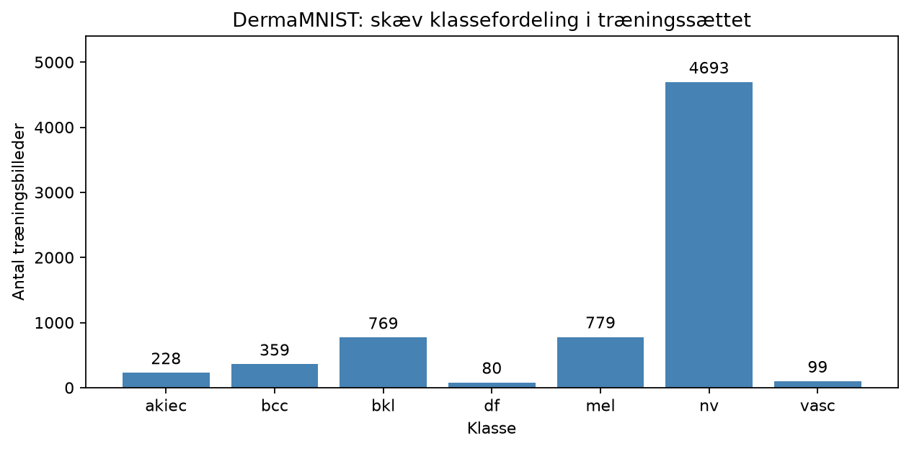
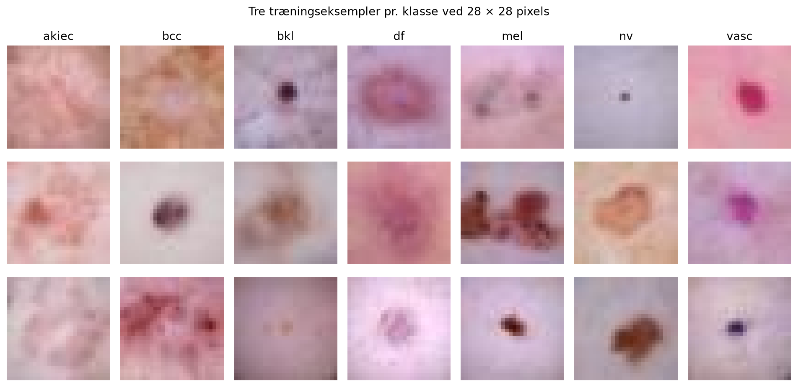
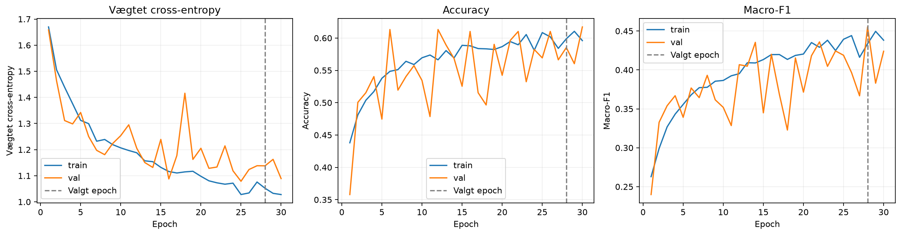
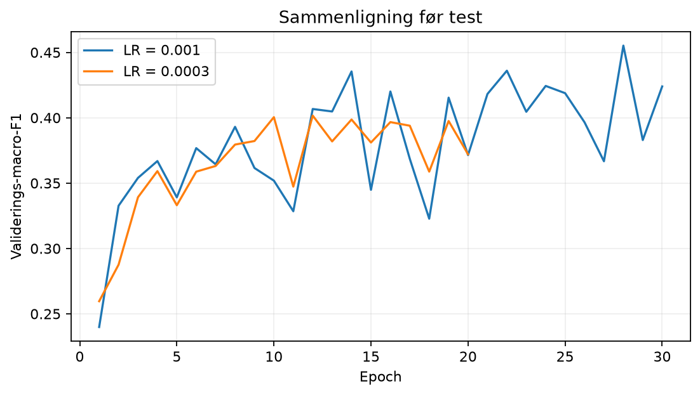
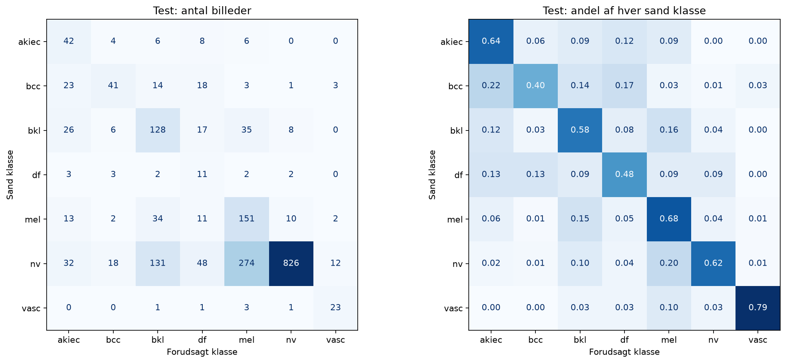
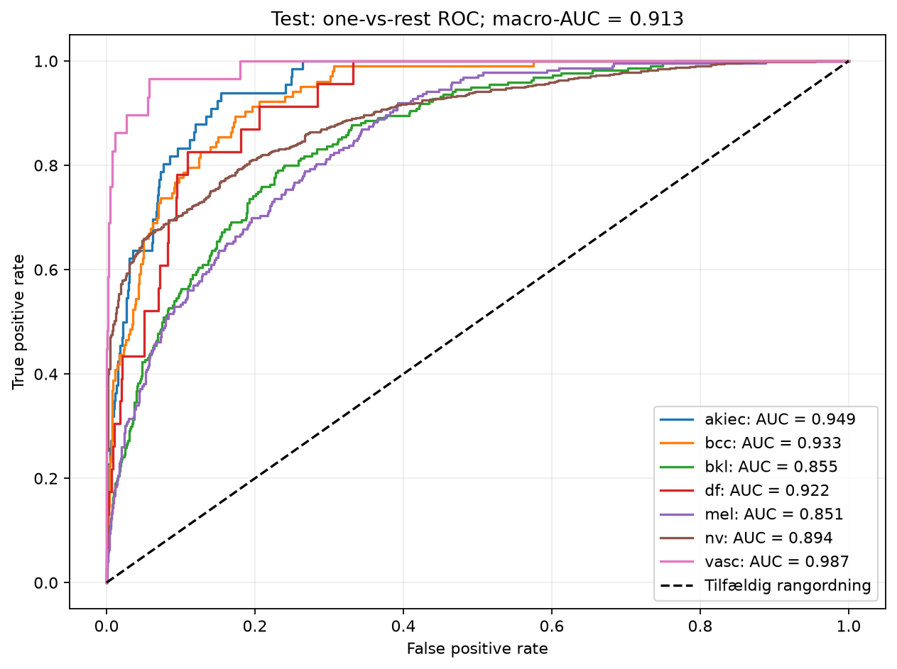
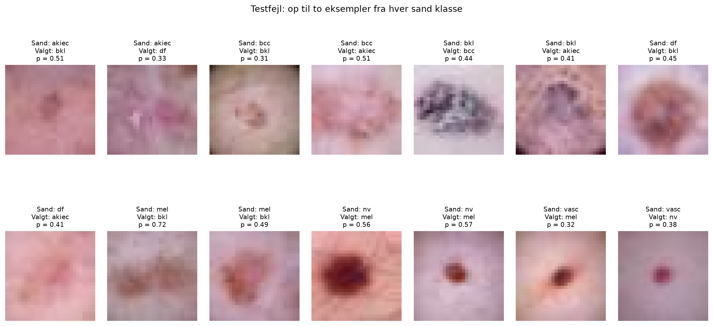

# Klassifikation af DermaMNIST med en enkel CNN

## 1 Introduction

Klassifikation af dermatoskopiske billeder undersøger, om billedmønstre kan
bruges til at skelne mellem typer af hudlæsioner. HAM10000 blev udviklet som
et offentligt datasæt til netop denne problemstilling [1]. En CNN kan lære
lokale mønstre og kombinationer af dem direkte fra billeder, mens en model
baseret på rå pixelafstande er følsom over for forskelle i blandt andet
placering og belysning. Det gør CNN'er relevante som metode til denne opgave.

DermaMNIST er MedMNISTs standardiserede udgave af HAM10000 [2]. Det officielle
benchmark giver en reference for billedklassifikation med blandt andet
ResNet-18. Formålet med dette arbejde er at undersøge, hvor godt en lille
CNN trænet fra bunden kan skelne mellem de syv DermaMNIST-klasser ved
28 × 28 pixels, og hvilke fejl der opstår. Der lægges særlig vægt på
klasseubalance, valideringsbaseret modelvalg og åben rapportering af testfejl.

## 2 Materials

Datasættet består af 10.015 RGB-billeder med én label pr. billede. De officielle
splits indeholder 7.007 træningsbilleder, 1.003 valideringsbilleder og 2.005
testbilleder. Opløsningen på 28 × 28 er valgt for at holde træning og analyse
overskuelig på CPU. Der bruges ikke opskalering, prætrænede vægte eller ekstra data.

| Label | Forkortelse | Klasse | Træning | Validering | Test |
| --- | --- | --- | ---: | ---: | ---: |
| 0 | akiec | actinic keratoses and intraepithelial carcinoma | 228 | 33 | 66 |
| 1 | bcc | basal cell carcinoma | 359 | 52 | 103 |
| 2 | bkl | benign keratosis-like lesions | 769 | 110 | 220 |
| 3 | df | dermatofibroma | 80 | 12 | 23 |
| 4 | mel | melanoma | 779 | 111 | 223 |
| 5 | nv | melanocytic nevi | 4693 | 671 | 1341 |
| 6 | vasc | vascular lesions | 99 | 14 | 29 |
| | | **I alt** | **7007** | **1003** | **2005** |

Fordelingen er meget skæv. Nv udgør 4.693 af 7.007 træningsbilleder, cirka
67 %, mens df kun har 80. Det gør accuracy utilstrækkelig som eneste mål.
Figur 1 viser ubalancen, og figur 2 viser tre træningseksempler fra hver klasse.

*Figur 1. Antal træningsbilleder pr. klasse. Optællingen er foretaget før træning.*

*Figur 2. Tre tilfældigt udvalgte træningseksempler pr. klasse med seed 42.
Billedkilde: DermaMNIST/MedMNIST og HAM10000, CC BY-NC 4.0 [1, 2].*

Eksemplerne varierer i farve, kontrast, læsionens størrelse og placering samt
baggrundens udseende. Både nv og mel rummer eksempelvis mørke områder på
lysere hud, mens samme klasse kan omfatte meget forskellige udseender.
Ved denne opløsning er mange detaljer udviskede. Disse observationer peger
på en vanskelig opgave, men er ikke bevis for de features, modellen bruger.

De officielle splits bevares for at følge benchmarkprotokollen. Der er dog
dokumenteret overlap af billeder af samme læsion mellem DermaMNISTs splits [3].
De er derfor ikke garanteret uafhængige på læsions- eller patientniveau.
NPZ-filen indeholder ikke de nødvendige id'er til at reparere dette sikkert
direkte i forsøget. Resultaterne skal fortolkes med denne begrænsning.

## 3 Methods

### Forbehandling og træningsdata

Pixelværdier skaleres fra 0–255 til 0–1 og standardiseres pr. RGB-kanal med
træningsdataenes mean = (0,7631; 0,5381; 0,5614) og std = (0,1366; 0,1543;
0,1692). Validering og test bruger de samme værdier. Kun træningsbilleder
spejles tilfældigt vandret og lodret, hver med sandsynlighed 0,5. Spejling
bevarer label og pixelinformation og øger variation i orientering. Farverne
ændres ikke, og der foretages ikke beskæring.

### Arkitektur

Modellen er en CNN fra bunden med 94.599 trænérbare parametre. Hver konvolution
har 3 × 3-kerne, stride 1 og padding 1 og efterfølges af batch normalization
og ReLU. To max-poolings reducerer den rumlige størrelse uden at reducere den
til 1 × 1 for tidligt. Global average pooling begrænser det sidste lags størrelse.

| Trin | Output pr. billede | Begrundelse |
| --- | --- | --- |
| Input | 3 × 28 × 28 | Tre originale farvekanaler |
| Conv 3→32, BatchNorm, ReLU, MaxPool | 32 × 14 × 14 | Lokale mønstre og første reduktion |
| Conv 32→64, BatchNorm, ReLU, MaxPool | 64 × 7 × 7 | Kombinationer af mønstre |
| Conv 64→128, BatchNorm, ReLU | 128 × 7 × 7 | Flere features uden yderligere max pooling |
| Global average pooling og Flatten | 128 | Få parametre i klassifikatoren |
| Dropout 0,3 og Linear 128→7 | 7 logits | Regularisering og multiclass-output |

Valget giver et netværk, hvis dimensioner og beregninger kan forklares direkte.
Der undersøges ikke transfer learning eller flere arkitekturer. Output er rå
logits til cross-entropy; softmax anvendes først til evaluering.

### Tab og optimering

Klassevægtet cross-entropy bruger vægten w_c = N/(7·n_c), beregnet udelukkende
på træningslabels. Sjældne klasser får større vægt. AdamW anvendes med weight
decay 0,0001 og batch size 128. Learning rate holdes konstant i hvert forsøg.
Dropout, augmentation og weight decay begrænser overfitting. Der er ikke
udført en ablation, så deres individuelle bidrag kan ikke udledes af resultaterne.

To learning rates, 0,001 og 0,0003, sammenlignes. Hver kandidat får maksimalt
30 epochs og early stopping efter otte epochs uden bedre validerings-macro-F1.
Den bedste epoch gendannes, og kandidaten med højest validerings-macro-F1
vælges. Testdata indgår hverken i gradienter, normalisering, klassevægte eller
checkpointvalg. Ved præcis lighed beholdes det først afprøvede resultat.

Et initialt uvægtet tab på 1,9402 var tæt på ln(7) ≈ 1,946. En separat
kontrolmodel opnåede 100 % på 28 træningsbilleder uden augmentation, dropout
eller weight decay efter 200 opdateringer. Kontrollen blev kasseret før
kandidatforsøgene og dokumenterer kun, at det lille træningsforløb virker.

### Reproducerbarhed og evalueringsmål

Forsøget blev kørt på CPU med Python 3.11.16, PyTorch 2.14.0, torchvision
0.29.0, MedMNIST 3.0.2, NumPy 2.4.6, scikit-learn 1.9.0 og Matplotlib 3.11.1.
Seed 42 blev nulstillet for hver kandidat, inklusive DataLoader-generatoren.
Der blev brugt fire CPU-tråde. Fuld konfiguration gemmes i `results/metrics.json`.

Den endelige CNN evalueres én gang på alle testbilleder. De gemte forudsigelser
bruges til alle efterfølgende analyser. En majoritetsbaseline forudsiger
altid nv, valgt ud fra træningsdata. Accuracy suppleres med balanced accuracy
(gennemsnitlig recall), macro-F1 (gennemsnit af klassernes F1), Cohen's kappa
og macro ROC-AUC med one-vs-rest. Desuden rapporteres precision, recall,
specificitet og F1 pr. klasse. Disse mål synliggør minoritetsfejl, som kan
forsvinde i samlet accuracy. Alle mål i tabellerne er på skalaen 0–1.

## 4 Results

### Modelvalg på valideringsdata

| Learning rate | Kørte epochs | Bedste epoch | Val macro-F1 | Val accuracy | Tid i sekunder |
| ---: | ---: | ---: | ---: | ---: | ---: |
| 0.001 | 30 | 28 | 0.4552 | 0.5852 | 186.4 |
| 0.0003 | 20 | 12 | 0.4017 | 0.6062 | 154.1 |

Learning rate 0,001 blev valgt ved epoch 28. Den anden kandidat stoppede ved
epoch 20 efter otte epochs uden forbedring siden epoch 12. Den valgte kandidat
havde bedre validerings-macro-F1, selv om den anden havde højere accuracy ved
sit bedste checkpoint. Det følger det på forhånd valgte udvælgelseskriterium.
De to træningsforsøg tog samlet cirka 340 sekunder.

*Figur 3. Trænings- og valideringsmål for learning rate 0,001. Den stiplede
linje markerer det valgte checkpoint. Træningsmål opsamles under opdateringer
med dropout og augmentation; validering måles efter hver epoch uden disse.*

*Figur 4. Validerings-macro-F1 for de to learning rates før testsættet anvendes.*

Træningstabet falder fra cirka 1,67 til 1,03, mens valideringsforløbet er mere
ustabilt. Macro-F1 svinger mellem epochs, og den sidste epoch er ikke den
bedste. Forløbet viser derfor værdien af at gendanne checkpointet. Det
dokumenterer ikke alene, hvad der forårsager udsvingene.

### Endelig test

| Model | Accuracy | Balanced accuracy | Macro-F1 | Macro-AUC OVR | Kappa |
| --- | ---: | ---: | ---: | ---: | ---: |
| Majoritetsbaseline | 0.6688 | 0.1429 | 0.1145 | Ikke beregnet | Ikke beregnet |
| Valgt CNN | 0.6095 | 0.5972 | 0.4808 | 0.9132 | 0.4157 |

CNN'en klassificerede 1.222 af 2.005 billeder korrekt. Den har lavere accuracy
end majoritetsbaselinen, men væsentligt bedre macro-F1 og balanced accuracy.
De to sidstnævnte mål viser, at den finder billeder fra alle syv klasser frem
for kun nv. Det vægtede testtab var 1,0874.

| Klasse | Antal | Precision | Recall | Specificitet | F1 | AUC OVR |
| --- | ---: | ---: | ---: | ---: | ---: | ---: |
| akiec | 66 | 0.3022 | 0.6364 | 0.9500 | 0.4098 | 0.9490 |
| bcc | 103 | 0.5541 | 0.3981 | 0.9826 | 0.4633 | 0.9332 |
| bkl | 220 | 0.4051 | 0.5818 | 0.8947 | 0.4776 | 0.8552 |
| df | 23 | 0.0965 | 0.4783 | 0.9480 | 0.1606 | 0.9219 |
| mel | 223 | 0.3186 | 0.6771 | 0.8187 | 0.4333 | 0.8513 |
| nv | 1341 | 0.9741 | 0.6160 | 0.9669 | 0.7547 | 0.8944 |
| vasc | 29 | 0.5750 | 0.7931 | 0.9914 | 0.6667 | 0.9872 |

*Figur 5. Rækker er sande klasser, kolonner er forudsigelser. Den højre
matrix viser andel af hver sand klasse; diagonalen er recall pr. klasse.*

*Figur 6. One-vs-rest ROC på de gemte testscorer. Macro-AUC er gennemsnittet
af de syv klasse-AUC-værdier og ikke accuracy ved argmax.*

## 5 Discussion

Forsøget viser en tydelig afvejning. CNN'en forbedrer macro-F1 fra 0,1145
til 0,4808 og balanced accuracy fra 0,1429 til 0,5972, men reducerer samlet
accuracy fra 0,6688 til 0,6095. Den kan derfor ikke beskrives som bedre på
alle mål. Den er bedre til at fordele genkendelsen over de syv klasser.
Resultatet er foreneligt med hensigten bag vægtet tab, men en uvægtet CNN-
sammenligning er nødvendig for at isolere effekten af netop vægtningen.

Den hyppigste forveksling var nv→mel med 274 billeder. Derudover blev 131
nv-billeder kaldt bkl og 48 kaldt df. Nv havde meget høj precision, 0,9741,
men recall 0,6160. Modellen forudsiger derfor nv forholdsvis selektivt.
Mel havde recall 0,6771 og precision 0,3186: 151 af 223 mel-billeder blev
fundet, men 323 andre billeder blev også kaldt mel. Den finder således
en del melanombilleder med mange falske positive som omkostning.

Df var særlig svag med F1 0,1606 og precision 0,0965. Kun 23 df-billeder
forekommer i testen; én ændret klassifikation flytter recall med cirka
4,35 procentpoint. Vasc havde recall 0,7931 og AUC 0,9872, men også kun
29 testbilleder. Små klasser kræver derfor forsigtig fortolkning.

*Figur 7. Op til to fejl pr. sand klasse, valgt i fast testorden. p er
softmax-scoren for den valgte klasse. Billedkilde: DermaMNIST/HAM10000 [1, 2].*

Fejleksemplerne viser, at lignende farver og grove former kan føre til
forvekslinger ved lav opløsning. Dette er en mulig forklaring, ikke en
valideret analyse af modellens indre features. Den relativt høje macro-AUC
0,9132 sammen med lavere accuracy viser også, at rangordning og korrekt
argmax-klassifikation er forskellige egenskaber. Scorerne er ikke undersøgt
for kalibrering og skal ikke læses som klinisk sikkerhed.

Den officielle MedMNIST v2-reference for ResNet-18 ved 28 × 28 er AUC 0,917
og accuracy 0,735 [2, 4]. Vores AUC er numerisk tættere på referencen end vores
accuracy. Det er ikke dokumentation for ligeværdige modeller: arkitektur,
træningsbudget, gentagelser og checkpointkriterium er forskellige. Referencen
er en publiceret baseline og omtales ikke som aktuel state of the art.

Begrænsningerne omfatter én seed, to learning rates, lav opløsning, få billeder
i små klasser og dokumenteret læsionsoverlap i standardsplittene [3]. Der
er ingen ekstern validering eller vurdering af ydeevne på tværs af patientgrupper.
En naturlig prioritet er et forsøg på læsionsadskilte eller eksterne data,
fulgt af flere seeds og kontrollerede forsøg med og uden klassevægte og
augmentation. Højere oprindelig opløsning eller en lille prætrænet model kan
også undersøges. Ingen af disse mulige forbedringer er allerede dokumenteret
af vores kørsel. Modellen er ikke ændret efter de rapporterede testresultater.

## 6 Conclusion

En lille CNN med 94.599 parametre blev trænet fra bunden på DermaMNIST med
et enkelt og reproducerbart forløb. Learning rate 0,001 og epoch 28 blev valgt
udelukkende på validerings-macro-F1. På standardtesten opnåede den accuracy
0,6095, macro-F1 0,4808, balanced accuracy 0,5972 og macro-AUC 0,9132.

Modellen genkender klasserne mere bredt end majoritetsbaselinen, men opnår
lavere samlet accuracy og har betydelige problemer med falske positive og
små klasser. Den vigtigste metodiske pointe er at kombinere valideringsbaseret
modelvalg med mål, der synliggør klasseubalance, og at beskrive datasættets
kendte begrænsninger. Resultaterne gælder dette benchmark og dokumenterer
ikke generalisering til nye patienter.

## References

[1] Tschandl, P., Rosendahl, C. & Kittler, H. (2018). *The HAM10000 dataset,
a large collection of multi-source dermatoscopic images of common pigmented
skin lesions*. Scientific Data 5, 180161.
[Artikel](https://doi.org/10.1038/sdata.2018.161).

[2] Yang, J. et al. (2023). *MedMNIST v2—A large-scale lightweight benchmark
for 2D and 3D biomedical image classification*. Scientific Data 10, 41.
[Artikel](https://doi.org/10.1038/s41597-022-01721-8).

[3] Abhishek, K., Jain, A. & Hamarneh, G. (2025). *Investigating the Quality
of DermaMNIST and Fitzpatrick17k Dermatological Image Datasets*. Scientific
Data 12, 196. [Artikel](https://doi.org/10.1038/s41597-025-04382-5).

[4] MedMNIST. [Officiel benchmarkside](https://medmnist.com/), tilgået
10. november 2026. Brugte ResNet-tal er publicerede referencer, ikke egne forsøg.

Opgavens struktur følger den udleverede Assignment 2 description.docx.
Den udleverede PDF-masterguide er brugt som faglig baggrund.
Alle egne tal i rapporten stammer fra den medfølgende notebooks gemte kørsel
og kan kontrolleres i `results/metrics.json` og `results/test_predictions.csv`.
